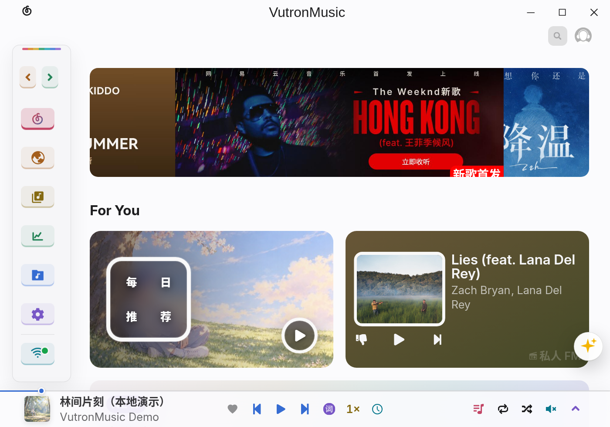
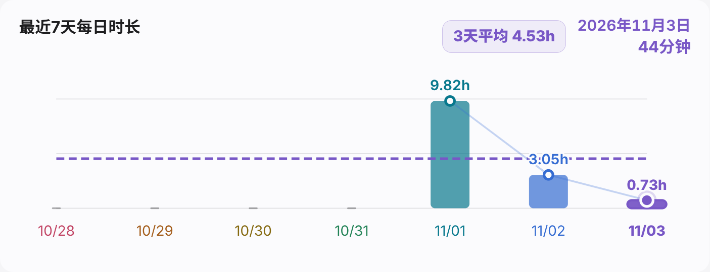
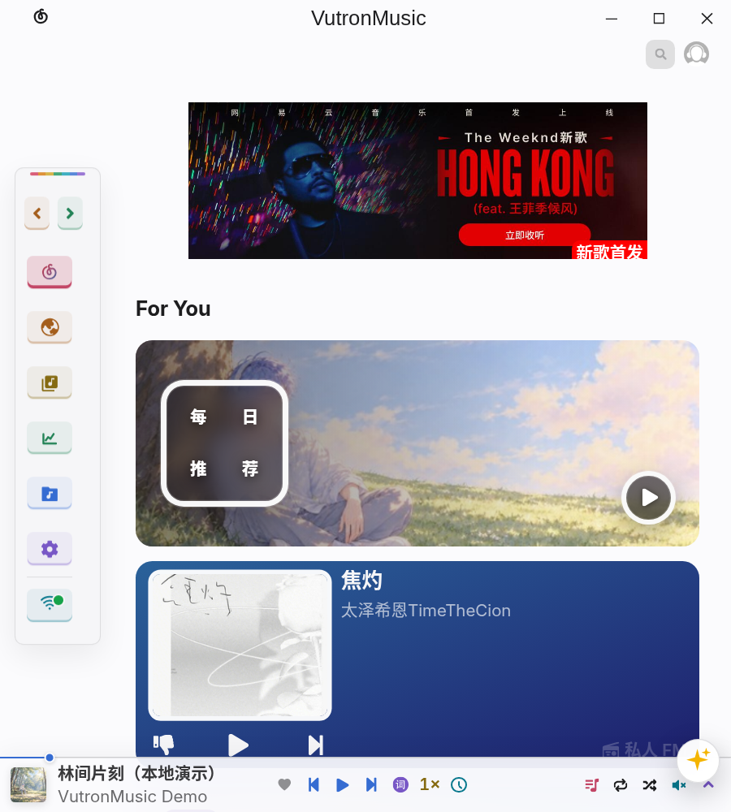

<p align="center">
  
</p>

# VutronMusic Custom

面向 Windows、macOS 与 Linux 的第三方网易云音乐桌面播放器，保留在线音乐、本地音乐和流媒体能力，持续完善心动推荐、歌词交互与跨窗口控制。

[下载与安装](#下载与安装) · [功能一览](#功能一览) · [界面与使用](#界面与使用) · [从源码运行](#从源码运行) · [反馈问题](#反馈问题)



> 本文与截图对应 `main` 分支的 **4.0 Beta** 开发版本。GitHub 上已发布的同版本号安装包可能早于当前提交；请以 Release 说明和源码提交为准，不把版本号相同视为内容完全一致。

## 功能一览

| 你想做的事 | 当前提供的能力 |
| --- | --- |
| 在线听歌与管理音乐 | 网易云账号、歌单、云盘、搜索、评论与歌词；本地歌曲与本地歌单；Navidrome、Jellyfin、Emby |
| 调整推荐方向 | 心动模式浮动助手、五种风格预设、多兴趣分支、会话反馈、多样性排序与滚动队列 |
| 看歌词、校正时间 | 普通与逐字歌词、主窗口与桌面歌词同步、单曲与全局时间校正 |
| 在桌面继续控制播放 | 普通 / 紧凑桌面歌词、锁定与局部鼠标穿透、托盘控制、快捷键、Linux MPRIS |
| 管理自己的播放节奏 | 队列历史与快照、睡眠定时器、歌曲缓存上限、变速、变调、均衡器与混响 |
| 回看听歌足迹 | 今日歌曲数、今日 / 本周 / 本月 / 累计收听、最近 7 天时长趋势与听歌排行 |
| 适配自己的窗口 | 宽窄布局、整体缩放、主窗口与桌面歌词的尺寸和字号设置 |

本仓库基于 [stark81/VutronMusic](https://github.com/stark81/VutronMusic) 二次开发，由 [bysanhz](https://github.com/bysanhz) 维护。它不是网易云官方客户端；在线资源的可用性仍取决于账号权限、服务端和网络环境。

## 界面与使用

### 心动模式：可以调整的推荐

点击界面右侧的 **✨** 打开心动助手。设置集中在同一个面板内，可选择连续、平衡、跳脱、探索或自定义风格，调整新鲜度、熟悉感、重复容忍度及兴趣分支。

自定义模式在网易云提供的候选上进行本地排序，并结合喜欢、跳过和实际播放反馈调整当前会话；“多来点这种”“跳远一点”用于临时改变推荐方向。关闭自定义算法后，新会话使用网易云原始推荐顺序，当前队列不会被立即替换。


开始心动模式需要登录网易云账号，并在“我喜欢的音乐”中有可用歌曲。原队列可从“播放历史与队列”的快照恢复。

### 听歌足迹：回看自己的收听习惯

进入“音乐洞察 → 听歌足迹”，查看今日歌曲数、本周、本月与累计收听时长。最近 7 天趋势可以按日期查看，也可切换本周与全部听歌排行。




听歌足迹需要登录网易云账号，统计随云端数据更新。

### 窗口自适应与自定义缩放

拉宽主窗口时并排浏览推荐，缩窄后卡片纵向排列；界面同时调整整体缩放，保留播放控制和侧栏入口。

<table>
  <tr>
    <th width="67%">宽窗口</th>
    <th width="33%">窄窗口</th>
  </tr>
  <tr>
    <td></td>
    <td></td>
  </tr>
</table>

在“设置 → 通用 → 主窗口缩放基准”中，可以调整最小宽度、最小高度和基准字号。修改时先预览，再确认或取消；桌面歌词也有各自的窗口设置。

<p align="center">
  
</p>

### 主窗口歌词：跟随音乐，也能校正时间

支持普通与逐字歌词。主窗口、桌面歌词和托盘歌词共用有效时间偏移；单曲校正按歌曲保存，并与全局校正叠加。播放页右键菜单提供本曲校正入口，正值让歌词提前，负值让歌词延后。


### 桌面歌词：普通与紧凑两种模式

点击播放栏的“词”按钮打开独立桌面歌词。普通模式展示滚动歌词与顶部播放控制，紧凑模式将封面和双行歌词放在一起；悬停封面可呼出播放控制。

**普通模式**


**紧凑模式**


悬停左侧封面后，可直接使用六个按钮：上排为上一首、播放 / 暂停、下一首，下排为显示 / 隐藏主窗口、心动模式、喜欢 / 取消喜欢。


桌面歌词支持拖动、缩放和锁定。紧凑模式锁定后，歌词区域可穿透，封面控制区仍可操作。字体、颜色、背景透明度和圆角可自行设置，样式可保存为预设；上图使用深色背景配色。

### 新素材与主题

当前应用使用统一的人物图标、彩色 / 白色 / 黑色托盘图标，以及森林、海边、雪地、樱花场景；主界面使用 Inter 字体并保留中文字体回退。浅色、深色、彩虹及自定义主题仍可切换。

真实曲目封面优先。默认场景用于缺少封面或封面恢复最终失败的情况，不替代能够正常取得的专辑图。默认头像保持原样。

## 下载与安装

前往 [GitHub Releases](https://github.com/bysanhz/VutronMusic_Custom4Mac-Linux/releases)，按自己的系统与架构选择安装包。当前已有 [4.0.0-beta.1 预发布版](https://github.com/bysanhz/VutronMusic_Custom4Mac-Linux/releases/tag/v4.0.0-beta.1)；如需当前 `main` 的最新修改，请从源码构建。

| 系统 | 发布架构 | 安装包 |
| --- | --- | --- |
| Windows | x64 | `.exe` 安装版 |
| Linux | amd64 / x86_64 | `.deb` |
| macOS | Apple Silicon / arm64 | `.dmg` |

其他架构可参考[本地构建说明](docs/development.md#本地打包)，在对应系统上构建。

### Linux

下载 DEB 后，在文件所在目录执行（将文件名替换为实际下载的文件）：

```bash
sudo apt install ./VutronMusic-4.0.0-beta.1_linux_amd64.deb
```

若要替换同版本号的本地测试包，使用 `sudo apt install --reinstall ./文件名.deb`。安装后从应用菜单启动 VutronMusic。

### Windows

运行与架构匹配的 EXE 安装包，按安装向导完成安装。

### macOS

打开 DMG，将 VutronMusic 拖入“应用程序”。当前构建未做 Developer ID 签名与 Apple 公证；若下载版被 Gatekeeper 拦截，在确认来源可信后，仅移除本应用的下载隔离属性：

```bash
xattr -dr com.apple.quarantine /Applications/VutronMusic.app
open /Applications/VutronMusic.app
```

不需要关闭系统全局安全检查。Intel Mac 可参考[本机构建说明](docs/development.md#本地打包)。

### 更新

在“设置 → 软件更新”中主动检查版本。应用启动时不自动检查更新；DEB、未签名 DMG 等手动安装格式按提示前往 Release 下载。安装更新后，请完整退出并重新启动应用。

## 从源码运行

需要 **Node.js ≥ 22.12.0、Yarn 1.22.22、Python 3 与本平台 C/C++ 构建工具**。原生依赖会针对 Electron 重建。

```bash
git clone https://github.com/bysanhz/VutronMusic_Custom4Mac-Linux.git
cd VutronMusic_Custom4Mac-Linux
yarn install --frozen-lockfile
yarn dev
```

检查、测试、各平台本地打包及工作流说明见[开发与构建指南](docs/development.md)。

## 反馈问题

请向[本仓库 Issues](https://github.com/bysanhz/VutronMusic_Custom4Mac-Linux/issues)反馈定制版本的问题，并附上系统与架构、应用版本、复现步骤，以及便于说明问题的截图。

## 致谢与许可

- 原项目：[stark81/VutronMusic](https://github.com/stark81/VutronMusic)
- UI 与功能参考：[YesPlayMusic](https://github.com/qier222/YesPlayMusic)、方格音乐
- 本地音乐统计参考：[NSMusicS](https://github.com/Super-Badmen-Viper/NSMusicS)
- 逐字歌词格式参考：[LDDC](https://github.com/chenmozhijin/LDDC)
- Electron 脚手架：[vutron](https://github.com/jooy2/vutron)

代码沿用 [MIT License](LICENSE)，保留上游与第三方版权声明。[Inter 字体许可](src/renderer/assets/fonts/Inter-OFL.txt)随字体保留。截图中的在线专辑、艺人及活动图片来自对应服务，相关权利归原权利人；项目新素材的接入记录见[资源说明](docs/design/prism-review-20261102/README.md)，界面图片的来源见[截图说明](.github/screenshots/README.md)。
