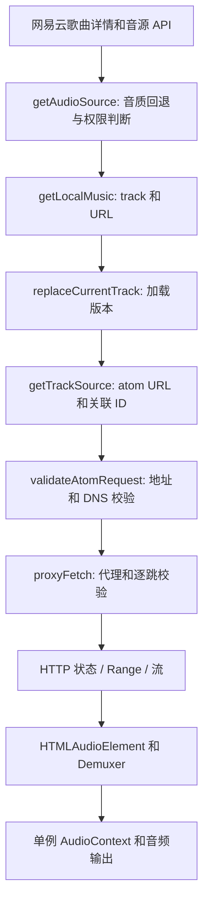

# VutronMusic 播放与内存诊断（2026-10-30）

## 执行边界和证据

工作仓库为 `bysanhz/VutronMusic_Custom4Mac-Linux`，分支 `main`。开始时本地 HEAD 是 `07d0c70`；HTTPS 独立查询远端后快进到 `4e3457421ba07512d1913bac6443571532d2de99`，没有覆盖未提交修改。SSH 查询失败，因此使用 HTTPS 读取远端。未推送、未发布 Release。

实测运行时为 Ubuntu 22.04 / kernel 6.8.0-134、Electron 37.10.3、Chromium 138.0.7204.251、Node 22.21.1。自动化由宿主 Node 22.22.3 和项目内 Playwright 执行。用户明确授权重启运行实例并启用本机调试。所有协议、持久化和内存故障夹具均使用临时 profile 与合成数据，不使用用户 Cookie 或伪造用户听歌记录。真实在线播放测试会正常记录实际听歌时间。

本机现有依赖目录还有版本漂移：`@neteasecloudmusicapienhanced/api` 实际为 4.30.2，清单声明为 4.40.1；Pinia 实际为 2.3.1、https-proxy-agent 为 7.0.6。打包器打印了依赖树告警，但目录包构建成功。本次未替换依赖或修改锁文件，所有实测结论适用于上述实际安装版本；干净安装后的 API 版本组合仍需后续回归。

数值证据见同目录 `2026-10-30-metrics.json`。原始本地采样和检查日志位于 `/tmp/vutron-audit-20261030/`；该目录不会上传。

## 播放失败：已复现并验证的根因

首次失败发生在 `src/main/security/runtimeSecurity.ts` 的 `validateAtomRequest()`，早于 `proxyFetch()`，并不是 CDN 返回 403。系统 DNS 将 `m7.music.126.net` 解析到 `198.18.0.102`。这是本机代理的 Fake-IP 地址；此前两个独立 DNS 校验把整个 `198.18.0.0/15` 判作保留地址，本地协议因此返回 403。该次请求没有到达 CDN。

同一时段，歌曲 `443854` 的 API 返回可用 URL。直接请求 HTTP 和 HTTPS 都得到 206、有效 Range 和音频字节；实际账户音质请求还返回了 FLAC，响应 MIME 为通用的 `audio/mpeg`。只修正 DNS 校验后，原播放器同一歌曲达到 `readyState=4`、进度正常前进。这一单变量结果确认了该现场的根因。不能据此断言所有其他播放失败都由 Fake-IP 导致。

修复只允许“网易云编号 CDN 主机名＋标准端口＋Fake-IP DNS 应答”这一组合；主机前缀仅为 `m数字[可选c]`、`p数字` 或 `s数字`，并且都限于 `.music.126.net` 后缀，不放开任意子域或公网域名。普通域名、字面 Fake-IP URL、内网/loopback/link-local 应答、混合内网 DNS 和跳转到不安全目标仍拒绝。缓存下载与协议入口使用相同地址策略，避免播放恢复但缓存仍被误拦截。UNM 的其他域名仍需满足公网 DNS 策略。



另一个已证实的代理缺陷是把 `https-proxy-agent` 通过 `agent` 传给 Node 原生 `fetch`。本地 HTTP 服务器实验显示 `agent` 完全没有被调用。Node 的 Fetch 使用 Undici dispatcher，参见 [Node 官方文档](https://github.com/nodejs/node/blob/main/doc/api/globals.md#custom-dispatcher)。现在使用 Node HTTP/HTTPS 流式客户端和已有的 Agent；CONNECT 代理夹具验证了一个本来无法解析的目标确实经代理访问成功。它是独立缺陷，并不是本次本地安全守卫 403 的起因。

## 恢复与资源生命周期

原代码的媒体 `error` 事件进入停滞恢复，而 `play()` 拒绝又进入音源重试，两个预算独立。单曲循环且音源不可用时，基线实际在十秒内发出 51 次歌曲信息请求。现在按加载版本去重，同一失败曲目一次刷新后仍失败就结束或进入下一首；整轮失败会有限停止。`MediaError.code=4` 记录为媒体打开失败，需要结合 HTTP 记录分类，不能单凭它断言编码不支持。

旧 `play()` Promise、淡出、缓存删除和曲目信息请求不能越过加载版本覆盖新曲目。用户取消造成的 AbortError 不进入故障重试。普通缓冲停滞仍使用十二秒 watchdog，但与媒体错误共享有限音源刷新预算。重新获取 URL 不保证上游一定给出不同 URL，因此诊断分别记录获取次数、结果和 `urlChanged`，不以加查询参数的方式伪装刷新。

`loadedmetadata` 的 `once` 监听器在始终没有 metadata 时不会自动消失。真实 Chromium 对照中，基线连续恢复三十次留下三十个监听器；现在每次加载显式取消上一加载的监听器，最多留下一个，reset/卸载后为零。100 次切歌和 30 轮失败没有增加 AudioContext 或音频元素的实例数。代理错误响应、重定向、取消和超时的流均有关闭测试。HTTP 内容编码采用流式解压，解压后删除不再有效的编码长度及 Range 字段；无法独立解压的压缩字节切片会明确失败，避免损坏媒体输入。这些生命周期问题有独立证据，但不能解释全部多 GiB 内存。

## 内存：已确认的触发链与仍未解释的现场

### 原主窗口现场

重启前现场主窗口 RSS 约 8.76 GiB，PSS 约 8.70 GiB，绝大多数是匿名私有页；其中约 8.37 GiB 的 RSS 标记为 `[anon:v8]`。映射标签不等于 JS Heap，也不能只凭它推出外部 ArrayBuffer、音频缓冲或某个 Vue 对象泄漏。原现场没有取得分配调用栈，因此这部分历史主窗口异常仍不能作唯一归因。

连续失败三十轮的短测未复现上述 GiB 规模。pitch worklet 按需创建并有 dispose，AudioContext 和 MediaElementAudioSourceNode 单例复用；封面 Blob URL、MediaSession artwork、歌词延迟任务和原生动画已有资源清理及回归覆盖。没有证据支持任意重建 AudioContext、增大 Heap Limit、定时 GC 或 Renderer 重启。

### 已复现的浏览器存储广播放大

持续实测中，主窗口相对平稳，但桌面歌词的 `partition_alloc` 随时间增长，JS Heap 仍约 5 MiB。听歌账本约 800 KiB，`flushNeteaseListenLedger()` 每五秒完整重写 `localStorage`，同源窗口收到带旧值和新值的 `StorageEvent`。

隔离 Electron 双窗口复现：100 次全量写入总计 83,598,192 个字符，接收 Renderer 的 PSS 从 25.58 MiB 到 188.17 MiB，JS Heap 几乎不变。改成基础快照与有界变更记录后，同条件只写 17,192 个字符，接收窗口 PSS 从 25.58 MiB 到 25.66 MiB。没有调用 GC。这与 [Chromium 351244335](https://issues.chromium.org/issues/351244335) 描述的同源闲置 Renderer 原生内存增长一致。

另外，真实 player Store 的持久化夹具发现：500 行逐字歌词使 `player` 快照达到 742,313 个字符，切换歌词行会反复序列化这一完整快照；排除临时字段后同一夹具仅为 502 个字符。歌词数组与当前歌词行都在每次加载时重建，因此将这两个临时字段排除出持久化；内存中的歌词和行号保持正常。这一补充通过 Store 测试验证，未包含在前面的账本 30 分钟对照内。

持久化修复保留原 v3 基础快照及完整主进程磁盘镜像，不删除历史或未核实记录。新变更记录保存更新、明确删除和元数据；超过 32 Ki 字符时合并为新的基础快照。基础版本号使合并中途退出遗留的旧变更记录失效，防止删除的条目重新出现。恢复不依赖主进程备份才能合并最后一个浏览器检查点；写入失败不会在内存中被错误标记为成功。

这一触发链已经由进程内存、Chromium 分配分类和合成场景证实。它解释了已复现的跨窗口原生内存增长；原先主窗口的巨大 V8 映射是否还存在其他来源，需要在下一次异常现场取得分配栈或 heap/native dump。播放失败本身与这一存储广播缺陷没有已证实的直接因果关系。

## 诊断工具与复现命令

保留设置页“一键诊断快照”。新增有界四十条音频请求记录，包括曲目/加载版本、阶段、脱敏主机、API 结果、HTTP 状态、Range、MIME、首包耗时、已传输字节、格式签名、重定向和中断。只保留主机，不记录完整 URL、Cookie、Token 或签名参数。JS 错误文本也会脱敏截断。

内存快照包括主进程 External/ArrayBuffer、Renderer V8/backing storage、Blink 和图片资源、Linux RSS/PSS/Private/Anonymous，以及最大两个进程的映射类别。V8 backing storage 不代表全部 Native Memory；分类之间也不能简单相加。不可获取的数值返回 null 或 unavailable。快照仍由用户在原入口复制，不自动上传。

```bash
# 项目类型检查、Lint 和构建
npm run vue:type-check
npm run lint
npm run build:pre

# 包括真实媒体元素、Web Audio、Range、错误恢复和内存广播的隔离测试
xvfb-run -a npx playwright test \
  tests/audio-proxy-transport.spec.ts \
  tests/player-playback-integration.spec.ts \
  tests/incremental-snapshot-storage.spec.ts \
  tests/storage-native-memory.spec.ts \
  tests/player-memory-resources.spec.ts --workers=2

# 结束已有实例以免端口/单实例锁冲突。以下保留本机现有的 --no-sandbox 调试启动方式。
npm run build:dir
env -u ELECTRON_RUN_AS_NODE NODE_ENV=production ./release/4.0.0-beta.1/linux-unpacked/vutron \
  --no-sandbox --remote-debugging-address=127.0.0.1 --remote-debugging-port=9222

# 另一终端：开始对应播放场景后只读采样
# Electron 启动参数：--remote-debugging-address=127.0.0.1 --remote-debugging-port=9222
node tools/audio-memory-audit.mjs --cdp http://127.0.0.1:9222 \
  --seconds 1800 --interval 15 --scenario normal-playback \
  --output /tmp/vutron-playback-memory.jsonl

# 异常发生时额外取得经过筛选的 Chromium allocator 分类
node tools/audio-memory-audit.mjs --cdp http://127.0.0.1:9222 \
  --seconds 0 --native-dump --scenario abnormal-memory \
  --output /tmp/vutron-native-memory.jsonl
```

调试端口仅应绑定本机。工具只采样，不切歌、不修改账本、不关闭应用、不清缓存、不强制 GC；结果保存在指定本地文件，若文件已存在则拒绝覆盖。完整 URL、账号及账本内容不会被采集。原生 dump 只导出有限的 allocator 名称与字节数，原始 trace 不落盘。

建议分别记录启动空闲、正常在线播放、100 次切歌、30 轮失败、探索/音乐库页面切换、暂停后空闲及关闭桌面歌词；不要把重启后的冷启动值当成同条件优化结果。实测完成范围和限制见下面的验证记录。

## 验证记录与限制

以最终提交对应的测试与实测汇总为准。相同诊断环境下，完整测试基线有 25 项失败，其中应用启动用例受到构建/运行实例条件影响，其余涉及 UI/历史源码断言；本次会保留失败清单，不能将全套测试描述为全绿。额外直接执行 `tsc --project tsconfig.node.json --noEmit` 也暴露出基线已有的大量依赖声明、严格空值及 shared 文件列表问题；项目正式的 `vue:type-check` 与构建检查单独报告。

Linux 已执行真实 Electron 测试。macOS 没有本机运行条件，属于未实测平台；代理客户端、Web Audio 和持久化修改不使用 Linux 专属 API，Linux 的 /proc 分类在其他平台返回不可用。

### 真实在线播放的两段 30 分钟采样

两组均使用曲目 `443855`、单曲循环、关闭自动缓存、同一 Linux/Electron 运行时；每十五秒一次，共各 121 个样本。持久化切换时重载了 Renderer，所以不将重载后的冷启动值下降解释为修复收益。受控合成实验才是隔离广播机制的直接前后比较。

| 观察对象 | 全量账本广播：开始 → 30 分钟 | 有界检查点：开始 → 30 分钟 |
|---|---:|---:|
| 主窗口 RSS | 419.98 → 549.66 MiB | 351.92 → 582.55 MiB |
| 主窗口 PSS | 335.34 → 461.30 MiB | 261.26 → 489.86 MiB |
| 桌面歌词 RSS | 270.45 → 1352.84 MiB | 135.68 → 164.83 MiB |
| 桌面歌词 PSS | 198.46 → 1273.15 MiB | 58.00 → 85.74 MiB |
| 主窗口 JS Heap used | 38.40 → 41.19 MiB | 41.10 → 45.16 MiB |
| 观察到的媒体错误 / watchdog 恢复 | 0 / 0 | 0 / 0 |

两组循环播放均继续前进。全量广播组有一个采样落在正常循环切换的暂停/重新加载边界，下一样本已恢复；没有把这一帧计为播放失败。这不是随机抽取大量不同歌曲的失败率统计。

桌面歌词的增长明显收敛，但仍存在约 28 MiB PSS 增量，不能宣称全天零增长。主窗口 RSS 本次并未降低，也没有复现原先的多 GiB V8 映射，因此不能声称主窗口历史内存问题已完全解决。其 V8 映射、Blink/embedder 分配与后续 native sampling 记录会保留，供再次异常时比较。当前会话尝试原生分配采样未得到可用调用栈，不能据此否定泄漏。

### 页面、停止和生产构建检查

在持久化修复后的开发实例中，完成探索/音乐库十次页面切换：主窗口 PSS 从暂停时约 499 MiB 上升至约 741 MiB；停止并空闲六十秒后回落至约 558 MiB，JS Heap 从约 138 MiB 回落至约 45 MiB。该短测不能证明所有 UI 路径长期无泄漏。关闭桌面歌词后，其独立 Renderer 从进程集合消失。迁移前检查的 1,006 条历史记录，在测试结束时仍全部存在且秒数未减少，期间新增了真实播放记录。

`build:pre` 与 Linux `build:dir` 已通过，没有发布 Release。打包目录内的应用使用隔离 profile 实际完成歌曲 `443854` 的 API → atom 代理 → 媒体元素播放，进度前进且 `readyState=4`；私网目标返回 403，诊断文本不含测试 Token。原有 `app.spec.ts` 直接启动未打包入口仍无法取得首窗口，其超时单独列为现有集成测试限制，不能用它否定已运行的打包应用测试，也不能将完整测试报告说成全绿。

### 最终自动化结果

| 检查 | 结果 | 解释 |
|---|---|---|
| `npm run vue:type-check` | 通过 | 项目正式 Vue/TypeScript 检查 |
| `npm run lint` | 通过 | 当前 src 全量 ESLint |
| `npm run build:pre`、`npm run build:dir` | 通过 | Linux 目录包，未发布 |
| 最终 Playwright 回归（排除已单独执行的 Environment check） | 346 通过，24 失败 | 失败名称与基线一致；新增 41 项全部通过 |
| 原 `app.spec.ts` Environment check | 失败 | 未打包入口首窗口超时；未计入上述 24 项 |
| 基线完整 Playwright | 305 通过，25 失败 | 包含原 Environment check；名单见 metrics |
| 独立 Linux 打包应用协议/真实播放 | 通过 | 歌曲 443854，进度 > 0.4 秒、readyState=4、无媒体错误；私网 403 与 Token 脱敏验证通过 |
| 独立 `tsc --noEmit --project tsconfig.node.json` | 失败 | 基线 366 条、当前 365 条诊断；既有项目列表、依赖声明和严格空值问题尚未解决 |
| macOS、全天稳定性、随机歌曲失败率 | 未运行 | 无本机 macOS；两次 30 分钟单曲测试不能替代这些验证 |

新增测试分为 HTTP/代理传输 19 项、真实播放器集成 12 项、检查点存储 7 项、真实账本模块重启恢复 2 项、双窗口原生内存对照 1 项。覆盖失效音源、403/404/5xx、HTML/JSON、Range/206、未知音频字节、重定向、代理生效、超时/中断/取消、编码响应、断网恢复、连续切歌、恢复期间切歌、用户暂停、有限停止、自动下一首、空 URL、监听器/音频节点释放和失败时间不累计。既有播放健康、心动模式、ListenSync/账本相关测试也在最终回归中执行；不声称已在服务器端核实网易云听歌分钟数。

最终回归命令：

```bash
XDG_CONFIG_HOME=/tmp/vutron-audit-20261030/final-check-profile \
  xvfb-run -a npx playwright test --workers=2 --grep-invert 'Environment check'
```

### 修改文件与功能边界

| 文件/模块 | 变更与原因 |
|---|---|
| `src/main/security/{validation,remoteUrl,runtimeSecurity,workerHttp}.ts` | 统一严格限定的网易云 CDN Fake-IP 策略；协议拒绝也写入有界关联记录，缓存使用相同策略 |
| `src/main/utils/{proxyFetch,remoteStream,audioProxyResponse,audioDiagnostics}.ts` | 实际使用现有代理 Agent；逐跳校验，保留 Range，关闭错误/取消流，正确解压，记录 HTTP 首次失败层 |
| `src/main/utils/index.ts`、`src/main/index.ts`、`src/shared/neteaseAssetUrl.ts` | 音源 API 结果与加载版本关联；完整编码 URL 避免签名参数被 atom URL 分割；保留旧地址兼容 |
| `src/renderer/store/player.ts` | 单次失败入口、有限刷新、切歌版本隔离、清理 metadata 监听器和旧 src；不持久化重新生成的歌词字段 |
| `src/renderer/utils/{neteaseListenLedger,incrementalSnapshotStorage}.ts` | 有界增量检查点替代每五秒全量广播；保留所有历史、听歌算法和完整磁盘备份 |
| `src/main/{runtimeDiagnostics,linuxProcessMemory}.ts`、`src/preload/index.ts` | 按需采集真实内存类别、进程变化与请求记录；不可用值不补零 |
| `src/renderer/{main,osdLyric}.ts`、`src/renderer/utils/diagnosticsSnapshotSettings.ts`、`src/shared/diagnosticRedaction.ts` | 兼容现有诊断入口，桥接内存采集并脱敏错误文本 |
| `tools/audio-memory-audit.mjs` | 有时限、只读、本机的内存/播放采样工具 |
| 新增测试及播放器夹具、两个既有测试文件 | 测试生产函数和真实 Electron 资源生命周期；更新受函数抽取影响的既有断言 |

没有修改主题、国际化、业务 UI、音质选择、心动推荐算法、听歌计时算法或 ListenSync 的核算规则，没有新增依赖。缓存/自动切歌仍使用原入口；在线失败恢复现在共享一次刷新预算，整队不可播放时会停止。这是有意的异常行为变更。主窗口多 GiB 内存的剩余调查应使用已提供工具保留下一次异常的 native dump，结合资源分类继续定位，不将本次收敛桌面歌词增长等同于解决全部内存异常。
